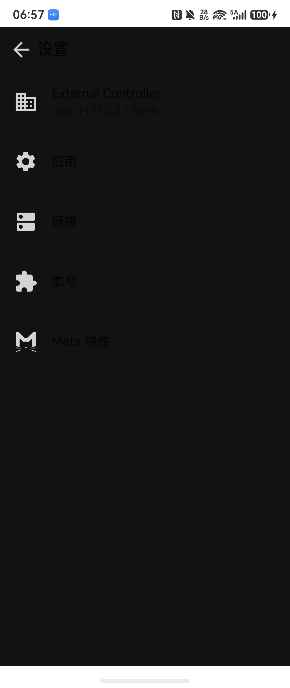
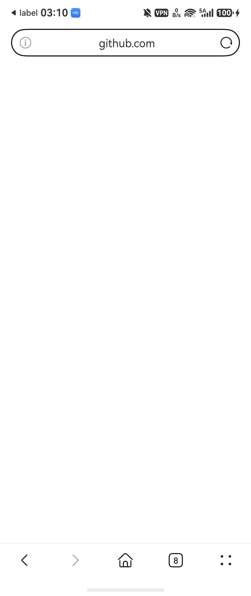

# ClashMetaHarmony

A working port of [ClashMetaForAndroid](https://github.com/MetaCubeX/ClashMetaForAndroid)
(CMFA) to HarmonyOS NEXT, built with [HomeTrans](https://gitcode.com/SMAT/HomeTrans)
plus the DevEco toolchain.

This is not a UI mock-up. The Android app's mihomo core is cross-compiled for
OHOS arm64, handed the TUN file descriptor by `VpnExtensionAbility`, and driven
from ArkTS through a small NAPI bridge. A real subscription is fetched, real
nodes are selected, and traffic actually goes through the tunnel on device.

Verified on **HUAWEI Pocket 2 (LEM-AL00), HarmonyOS 7.0.0.109, API 26**.

<p>
  
  
</p>

---

## Status

17 of CMFA's 20 activities are ported. The three that are not are documented
with reasons, not silently dropped (see `docs/ClashMetaHarmony-PORT-STATUS.md`).

| Area | State |
|---|---|
| Main screen (status card, live traffic, providers) | working, device-verified |
| Proxy screen (groups, selection, delay test, filters, layout) | working, device-verified |
| Profiles / new / edit / file browser / properties | working, device-verified |
| Settings, app settings, network settings, override, Meta features | working, device-verified |
| Access control (trusted / blocked app lists) | working; app enumeration is refused by the platform (see below) |
| Logs (local file mode) | working |
| Logcat streaming | **not ported** — see `docs/logcat-streaming-harmonyos-feasibility.md` |
| Service card (`EntryFormAbility`) | working |
| Static shortcuts + `clash://toggle\|start\|stop` | working, device-verified |
| VPN / TUN data path | working, device-verified |

### What actually runs

```text
UI process (EntryAbility, ArkTS)
  |  HTTP 127.0.0.1:9090
  v
VpnExtensionAbility process (com.example.clashmeta:vpn)
  |  NAPI  (libclashcore.so -> libclash.so)
  v
mihomo core (Go, GOOS=android GOARCH=arm64, OHOS clang)
  |  tun fd from vpnExtension.create()
  v
vpn-tun 172.19.0.1/30, MTU 9000
```

The UI never links the core directly. It talks to the core's own external
controller over loopback, which is the same contract CMFA's
`ExternalControlActivity` uses. `docs/mihomo-external-controller-api-verified.md`
records which endpoints were verified against the real core and where the
public API description is wrong.

### Measured on device

- `vpn-tun` up at `172.19.0.1/30`, MTU 9000, controller listening on
  `127.0.0.1:9090`
- real subscription fetched, `WantVPN` active, real node selected
- `https://github.com` loaded in the device browser through the tunnel
- 150 s continuous run with no `FdLeakInfo` and no process loss
- stop -> direct networking restored -> start -> tunnel back
- stack switch `gvisor` <-> `system` from the Network settings menu, both attach

---

## Building

### Prerequisites

- DevEco Studio with the HarmonyOS SDK (this port targets API 26 / HarmonyOS 6.0
  Beta1; the SDK ships `hvigorw` and the OHOS NDK)
- Node.js 22+
- a signed HarmonyOS app profile for your device

### The core (`libclash.so`) is not in this repository

`libclash.so` is a 62 MB Go shared library. It is deliberately kept out of git:
it is 94% of the built HAP and it is reproducible. Build it with
[`core/build-core.sh`](core/build-core.sh) — see [`core/README.md`](core/README.md)
for the toolchain details and the exact `go build` invocation. The two things
this project adds on top of upstream mihomo are in `core/`:

- `core/ohos-main.go` — the cgo export surface the NAPI layer calls
- `core/gvisor-ohos-fstat-fallback.patch` — lets the `gvisor` TUN stack start on
  an OHOS VPN fd (see `docs/gvisor-mixed-tun-stack-ohos.md`)

Place the result at `entry/src/main/cpp/prebuilt/arm64-v8a/libclash.so`.

### Build and install

```bash
cd entry && ohpm install
hvigorw assembleHap --mode module -p product=default
hdc install -r entry/build/default/outputs/default/entry-default-signed.hap
hdc shell aa start -a EntryAbility -b com.example.clashmeta
```

Signing is configured in `build-profile.json5`; the module declares
`ohos.permission.INTERNET`, `ohos.permission.GET_BUNDLE_INFO` and
`ohos.permission.KEEP_BACKGROUND_RUNNING`.

---

## Two things worth knowing before you change anything

**The VPN process gets killed by the FD leak detector if outbound sockets are
not protected.** OHOS's `FdLeakDetector` ends the VPN process when the fd count
explodes; without per-socket protection the Go core's dialers loop back into the
TUN and the count reaches five figures in about 90 seconds. The fix is
`protectProcessNet()` before core start *plus* an Android-style per-socket
`markSocket` callback wired through NAPI. `docs/ClashMetaHarmony-PORT-STATUS.md`
section 28 has the log evidence.

**Several platform limits are real and measured, not assumed.** Installed-app
enumeration, system-wide HTTP/PAC proxy, quick-settings tiles and dialer secret
codes have no public third-party API on this platform. Each one is recorded with
the exact SDK permission level or the exact `BusinessError` the device returned,
in `docs/ClashMetaHarmony-PORT-STATUS.md` section 29, together with what was
done instead.

---

## What else is in here

**`skill/hmos-vpn-app-port/`** — a portable skill distilled from this port, for
the next Android app of the same class (Clash, sing-box, v2ray, WireGuard, any
native core behind a TUN). It covers the descriptor lifecycle, the fd-leak trap,
the OHOS arm64 core build, the measured platform limits, and a device check
script you can run:

```bash
./skill/hmos-vpn-app-port/scripts/vpn-device-check.sh com.example.clashmeta vpn-tun 9090 3
```

**`docs/hometrans-feedback/`** — eight issue write-ups against HomeTrans, the
workflow used for this port. Each one has a file path plus a line number, or a
quoted command output. Two are bugs that break a fresh install; one records a
wrong platform conclusion the workflow allowed and the process change that
prevents it. `docs/hometrans-feedback/tool-combination.md` covers which tool is
authoritative for which question.

---

## License

GPL-3.0. This is a derivative work of ClashMetaForAndroid (GPL-3.0) and
redistributes a build of [mihomo](https://github.com/MetaCubeX/mihomo)
(GPL-3.0). See [`LICENSE`](LICENSE) and [`NOTICE`](NOTICE).
